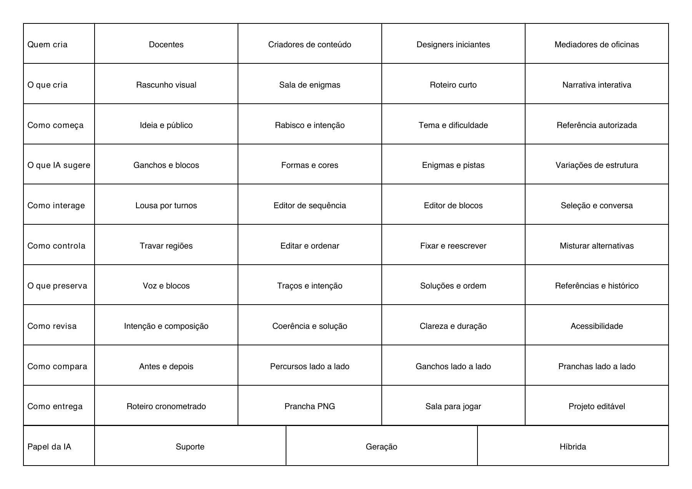

# Projeto Ferramenta - Criatividade Computacional

Exploração de três ferramentas que permitem a outra pessoa criar com IA:

1. **EscapeRoom AI:** criar uma sequência jogável de enigmas.
2. **RoteiroLab:** criar roteiros curtos com ganchos alternativos e blocos cronometrados.
3. **Arena Visual:** criar rascunhos visuais em uma lousa compartilhada com um agente.

Este repositório é um fork público de [text-to-morphbox, de Filipe Calegario](https://github.com/filipecalegario/text-to-morphbox). O gerador Python original foi preservado e executado com os dados deste projeto.

## Revisar a caixa



- [Caixa morfológica em PDF](output/pdf/caixa-morfologica.pdf)
- [Três ideias no mesmo formato](docs/ideias.md)
- [PF0: processo e os três caminhos](docs/pf0-caixa-e-caminhos.md)
- [Requisitos e entregas essenciais de PF0 e PF1](docs/requisitos-e-entregas.md)
- [PF1: preparação para a escolha e o pitch](docs/pf1-preparacao.md)
- [Registro de processo e reprodução](docs/processo.md)

**Escolha do caminho:** pendente. Matheus decidiu revisar a caixa antes de escolher; nenhuma das três ideias foi selecionada para desenvolvimento.

PF0 e PF1 têm prazo em **20/10/2026**, conforme os enunciados consultados em 19/10. A duração do pitch aparece como cinco minutos em PF1 e três no lançamento do projeto; a preparação adota três minutos provisoriamente.

## Gerar novamente

Requer Python 3 e ReportLab. Uma instalação isolada:

```bash
python3 -m venv .venv
.venv/bin/python -m pip install -r requirements.txt
PYTHON=.venv/bin/python bash scripts/gerar-caixa.sh
```

O script executa `python/text_to_morph.py` a partir de `python/`, onde o programa espera encontrar `input.txt`. A saída nativa é `python/output.pdf`; a cópia para entrega fica em `output/pdf/caixa-morfologica.pdf`. Se Poppler estiver instalado, a prévia PNG também é atualizada.

O formato de entrada original continua sendo uma categoria por linha e alternativas separadas por vírgula:

```text
Categoria: Alternativa A, Alternativa B, Alternativa C
```

As escolhas de cada caminho estão em [data/caminhos.json](data/caminhos.json). Edite esse arquivo junto com `python/input.txt` ao revisar a caixa e depois rode:

```bash
PYTHON=.venv/bin/python bash scripts/gerar-caixa.sh
.venv/bin/python scripts/validar-caixa.py
```

O que está implementado aqui é a geração da caixa em PDF. EscapeRoom AI, RoteiroLab e a extensão visual da Arena são conceitos para avaliação. O repositório mantém também a implementação Java e os exemplos herdados do upstream.
