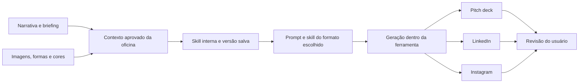

# Oficina em Prancha: narrativa visual e skill interna

**Direção de produto informada em 20/10/2026.** Este documento atualiza a proposta e o planejamento. A experiência descrita ainda não foi implementada.

## O que mudou

A entrega central passa a ser uma **skill interna por palestra ou oficina**, construída a partir da narrativa e das decisões visuais do usuário. Durante a criação, a pessoa vê imagens, formas e cores. Ao final, escolhe um formato de saída, como pitch deck, post de LinkedIn ou conteúdo para Instagram. Cada opção combina o contexto da oficina com um prompt e uma skill próprios para gerar aquele conteúdo.

O autor definiu **Electron como plataforma desktop**, com aplicativo baixável para uso interno, e um repositório privado separado para sua construção. A geração e a revisão das saídas acontecerão no próprio app. Sistemas operacionais-alvo, instaladores e fornecedor de IA ainda precisam ser definidos; uso interno não estabelece funcionamento integral sem internet.

A [proposta sorteada](experimentos/2026-10-19-sorteio-rcd/proposta-02.md) tinha roteiro curto e prancha PNG como escolhas obrigatórias. A nova direção foi dada pelo autor depois da seleção. Ela altera o escopo; não deve ser apresentada como reprodução integral daquele caminho. Sorteio, prompts, propostas e parecer originais permanecem como evidência histórica. O [pitch anterior](https://github.com/MathBorgess/projeto-ferramenta-criacomp/blob/f7d3ef162595d01fd8ec685422e6d264cc658282/docs/pitch-oficina-em-prancha.md) documenta a entrega anterior.

Esta skill interna pertence ao produto que estamos propondo. A skill genérica `morphological-project-design`, do skills-catalog, organiza o processo de escolher projetos; são artefatos com funções distintas.

## Decisões e proposta de implementação

| Parte | Direção fornecida pelo autor | Recorte sugerido para desenvolvimento |
| --- | --- | --- |
| Plataforma | Aplicativo desktop Electron, baixável e utilizado internamente | Definir sistemas-alvo e empacotamento; construção em repositório privado separado |
| Criação | Construir a narrativa vendo imagens, formas e cores | Blocos de narrativa ao lado de um painel visual, com sugestões de IA editáveis |
| Contexto | Guardar todo o contexto da palestra/oficina numa skill interna | Separar instruções, contexto estruturado, decisões e arquivos visuais; salvar versões |
| Saídas | Escolher formatos; exemplos: pitch deck, LinkedIn e Instagram | Três adaptadores limitados, reutilizando uma versão aprovada do contexto |
| Geração | Cada formato usa prompt + skill | Carregar contexto da oficina + instruções do formato + pedido específico |
| Entrega técnica | Conteúdo gerado dentro da ferramenta, confirmado pelo autor em 20/10 | Geração, prévia, edição e salvamento no mesmo ambiente; contexto e skills usados internamente |

O nome Oficina em Prancha e o foco inicial em facilitadores independentes são mantidos como continuidade da proposta, sem nova decisão de marca ou pesquisa de público.

## Experiência do usuário

1. **Abrir o app e situar a oficina.** No aplicativo instalado, informar tema, público, objetivo, duração e o que deseja que a audiência compreenda ou faça.
2. **Construir a narrativa.** Organizar abertura, mensagem central, exemplos, atividades e fechamento. Pedir alternativas à IA e editar os blocos diretamente.
3. **Explorar o visual enquanto escreve.** Ver imagens e combinações de formas e cores relacionadas aos blocos. Escolher referências, comparar sugestões e preservar o que já aprovou.
4. **Salvar a base da oficina.** Guardar o contexto narrativo e visual aprovado. A pessoa pode fechar e reabrir o projeto sem repetir o briefing.
5. **Escolher a saída.** Selecionar formato, objetivo daquele material e preferências. O conteúdo parte da oficina existente.
6. **Gerar, revisar e concluir na ferramenta.** Receber o conteúdo do formato escolhido, comparar com a narrativa, editar e salvar no mesmo ambiente. Ligar a saída à versão utilizada, preservando versões anteriores.

Na interface, apresentar narrativa, referências visuais e saídas. A estrutura técnica da skill fica interna; não é necessário que o usuário saiba escrever ou instalar uma skill para criar sua oficina.

## Como o contexto interno pode funcionar

Estrutura proposta para planejamento, não um formato já implementado:

```text
oficina/
  SKILL.md          instruções para usar o contexto e respeitar decisões aprovadas
  context.json      público, objetivo, narrativa, voz e escolhas visuais
  assets/           imagens escolhidas e referências visuais
  versions/         versões do contexto e das decisões
  outputs/          conteúdos gerados e sua versão de origem
```

O contexto deve incluir os blocos narrativos, fatos e exemplos fornecidos, decisões aprovadas, tom de voz, imagens selecionadas, descrições visuais, paleta, formas e relações entre esses elementos. Os arquivos de imagem precisam continuar disponíveis; apenas citar seu nome no texto não preserva o recurso visual.

A skill define como trabalhar com essa base; o contexto e os arquivos preservam o conteúdo da oficina. Não depender apenas do histórico do chat. Cada saída registra qual versão do contexto, prompt e skill de formato utilizou. Edições manuais aprovadas não devem ser sobrescritas por uma nova sugestão.



## Adaptadores de saída

Os exemplos abaixo delimitam resultados testáveis. Regras de quantidade e tamanho são parâmetros de template, ainda a validar com o grupo.

| Formato | O que reutiliza da oficina | Resultado mínimo proposto |
| --- | --- | --- |
| Pitch deck | Problema, público, narrativa, exemplos, mensagem e identidade visual | Sequência de slides com títulos, conteúdo e composição visual em template |
| LinkedIn | Ideia central, voz, exemplos e objetivo de comunicação | Post editável com abertura, desenvolvimento e fechamento; opção de arte ligada ao visual aprovado |
| Instagram | Sequência narrativa, trechos curtos e identidade visual | Carrossel em template com legenda e prévia dos cartões |

A geração e a revisão do conteúdo acontecerão dentro da ferramenta, conforme decisão do autor em 20/10. O usuário escolhe o formato e recebe o conteúdo; prompt e skill são componentes internos dessa geração. As extensões de download, como PPTX editável, PDF ou PNG, ainda precisam ser definidas. Recomenda-se começar com conteúdo editável e prévias em templates, evitando prometer um editor completo para cada formato.

## Recorte de MVP proposto

- Um usuário e uma oficina por projeto, com salvamento e reabertura.
- Editor por blocos e painel que mostre imagens, formas e cores durante a criação.
- IA sugerindo texto e parâmetros visuais; usuário escolhe, edita e confirma.
- Imagens fornecidas ou escolhidas pelo usuário no primeiro ciclo. Geração de imagens por modelo é uma extensão a avaliar; visualizar imagens já faz parte do ciclo mínimo.
- Skill/contexto interno versionado e reaproveitado por três adaptadores simples.
- Geração, prévia, edição e salvamento das saídas dentro da ferramenta; exportação limitada aos formatos técnicos acordados.

Para esse recorte, não são necessários publicação automática nas redes, colaboração simultânea, um editor visual livre ou integração com clientes externos de agentes. Esses recursos não foram pedidos como requisitos do primeiro ciclo.

## Hipótese de valor e validação comercial

O comprador inicial proposto continua sendo quem prepara palestras e oficinas como parte de uma atividade profissional. A hipótese é reduzir repetição de briefing, correções e inconsistências ao transformar uma mesma narrativa em vários materiais. “Guardar uma skill” é o mecanismo; o benefício precisa aparecer no trabalho que a pessoa consegue concluir e reutilizar.

O preço de R$149, a contribuição de R$13 e a estimativa de quarenta horas pertencem ao escopo anterior de uma prancha PNG. Não são orçamento, preço ou margem desta nova entrega. Recalcular geração por formato, armazenamento de imagens, revisões, suporte, aquisição e desenvolvimento antes de propor cobrança.

Teste futuro sugerido: oferecer uma entrega por oficina com uma quantidade explícita de formatos e revisões. Medir custo total e disposição a pagar pelo conjunto. Não usar alcance de posts ou promessa de novos contratos como receita observada. Nenhuma oferta ou cobrança foi realizada nesta atualização.

## Diferenciação a verificar

O [levantamento de Miro e Canva](referencias/2026-10-19-taaft-miro-canva.md) foi registrado em 19/10 para o escopo anterior, com limitações de acesso e taxonomia. Ele não demonstra exclusividade desta nova direção. A comparação específica de narrativa visual persistente e múltiplas saídas ainda precisa ser feita.

Hipótese de diferencial: manter as decisões narrativas e visuais aprovadas ao gerar novos materiais, com menos rebriefing e retrabalho. Comparar o ciclo completo com o fluxo habitual do público, inclusive quando combina um modelo de linguagem e um editor visual. Usar o mesmo conteúdo, os mesmos formatos e critérios de qualidade definidos antes da comparação.

## Critérios para o próximo protótipo

| Verificação | Evidência esperada |
| --- | --- |
| Criação visual durante a narrativa | A pessoa vê e altera imagens, formas e cores antes de escolher uma saída |
| Persistência | Fechar e reabrir mantém briefing, blocos, arquivos visuais e escolhas aprovadas |
| Reutilização | Gerar, visualizar, editar e salvar os três formatos na ferramenta, a partir da mesma versão e sem repetir o briefing |
| Fidelidade | Fatos, mensagem, voz e visual aprovado continuam reconhecíveis nas saídas |
| Controle | Uma regeneração não apaga edições ou saídas anteriores |
| Utilidade | Pessoa conclui o ciclo sem orientação por cima do ombro; registrar tempo e correções |
| Viabilidade | Medir custo por criação, por formato e por revisão; reestimar esforço antes de congelar |

Os marcos acadêmicos registrados continuam sendo referências de planejamento: arquitetura/baixa fidelidade em 27/10, ciclo ponta a ponta em 10/11, teste externo em 12/11 e congelamento em 17/11. Não houve nova consulta ao calendário da disciplina nesta atualização. O teste mais cedo deve ser salvar uma oficina visual e reutilizá-la em duas saídas; os três adaptadores compõem a meta proposta do ciclo completo.

## Decisões de implementação ainda abertas

- Extensões e nível de acabamento exigidos em cada saída.
- Sistemas operacionais-alvo, instaladores e forma de distribuição interna.
- Fornecedor/modelo de IA, credenciais e dependência de rede.
- Divisão de trabalho e capacidade do grupo para cumprir o novo escopo.

Método comercial de referência: [Revenue-Centric Design, Richard (@richardrx)](https://github.com/heliocosta-dev/revenue-centric-design/tree/1942760c2242f609bf63ce2c97204f5a1791bd68). Preservados os [termos completos aplicáveis](experimentos/2026-10-19-sorteio-rcd/RCD-LICENSE.txt).
